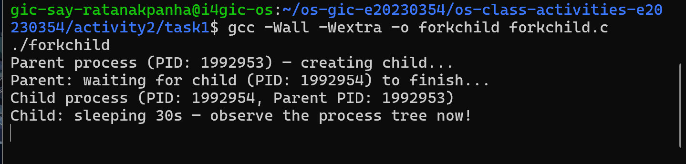
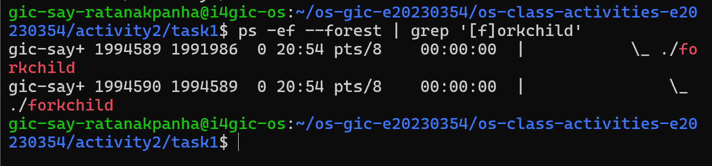
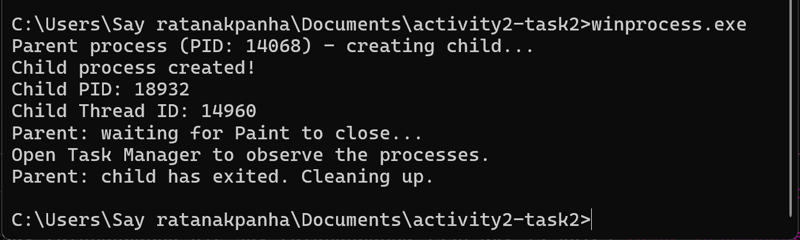
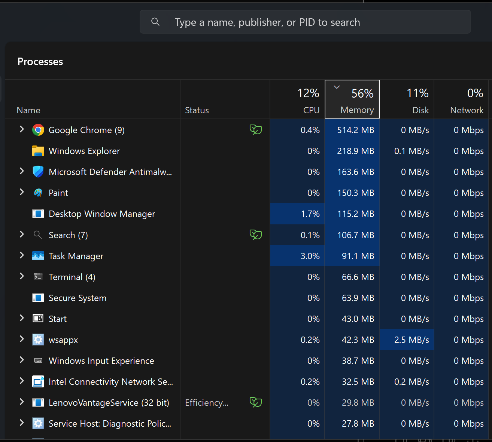
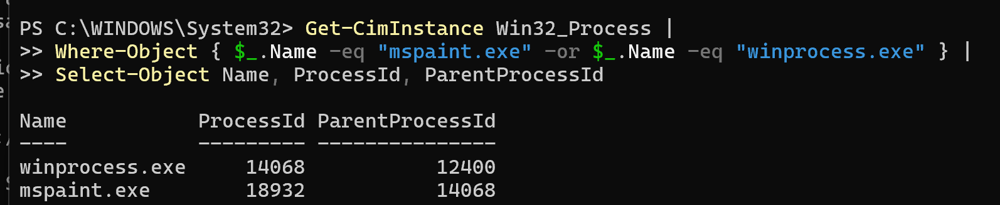
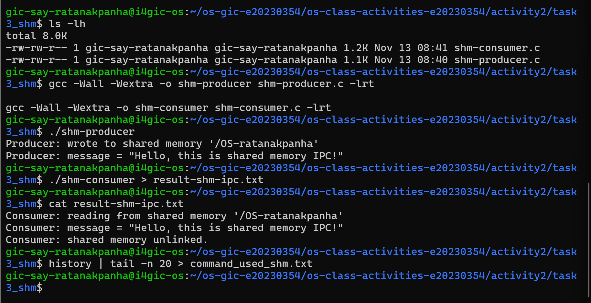
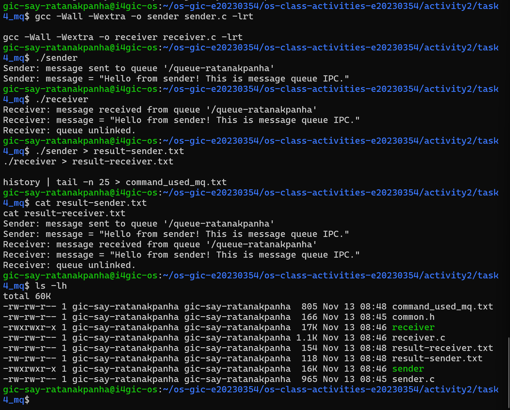

# Class Activity 2 — Processes & Inter-Process Communication

- **Student Name:** Say Ratanakpanha
- **Student ID:** e20230354
- **Date:** 13 November 2026
- **Course:** Operating Systems

---

# Task 1: Process Creation on Linux (fork + exec)

## Compilation & Execution

Screenshot showing compilation and execution of `forkchild.c`:



## Process Tree

Screenshot showing the parent-child process relationship:



## Output

```text
Parent process (PID: 1992553) — creating child...
Parent: waiting for child (PID: 1992554) to finish...
Child process (PID: 1992554, Parent PID: 1992553)
Child: sleeping 30s — observe the process tree now!
Child: now executing 'ls -la'...
[Directory listing produced by ls -la]
Parent: child exited with status 0
Parent: done.
```

## Questions

**1. What does `fork()` return to the parent? What does it return to the child?**

`fork()` creates a new child process by duplicating the calling process.

- In the parent process, it returns the PID of the newly created child.
- In the child process, it returns `0`.
- If the operation fails, it returns `-1`.

In my experiment, the parent received PID `1992554`, while the child received `0` from `fork()`.

**2. What happens if you remove the `waitpid()` call? Why might the output look different?**

If we remove `waitpid()`, the parent does not wait for the child to finish.

The parent may continue and terminate before the child completes its work. Therefore, the output order may be different. The child may continue running as an orphan process if its parent terminates.

Using `waitpid()` allows the parent to wait for the child and collect its termination status.

**3. What does `execlp()` do? Why don't we see "execlp failed" when it succeeds?**

`execlp()` replaces the current process image with a new program.

In my program, the child uses `execlp()` to execute the `ls -la` command.

When `execlp()` succeeds, it does not return to the original program because the child process has been replaced by the `ls` program.

The error message is only displayed if `execlp()` fails.

**4. Draw the process tree for your program (parent → child). Include PIDs from your output.**

```text
Parent Process
PID: 1992553
    |
    └── Child Process
        PID: 1992554
        PPID: 1992553
        |
        └── Executes ls -la
```

The child process was created by the parent using `fork()`. The child then executed `ls -la` using `execlp()`.

**5. Which command did you use to view the process tree (`ps --forest`, `pstree`, or `htop`)? What information does each column show?**

I used the `ps` command with the `-ef --forest` options to inspect the process hierarchy.

The command is:

```bash
ps -ef --forest
```

The important columns include:

- **UID:** User who owns the process.
- **PID:** Process ID.
- **PPID:** Parent Process ID.
- **C:** CPU utilization information.
- **STIME:** Process start time.
- **TTY:** Terminal associated with the process.
- **TIME:** CPU time used by the process.
- **CMD:** Command used to start the process.

The forest option displays the process hierarchy, making it easier to understand the parent-child relationship.

---

# Task 2: Process Creation on Windows

## Compilation & Execution

Screenshot showing compilation and execution of `winprocess.c`:



## Task Manager Screenshots

### Processes Tab — Process Tree



### PID and Parent PID Verification



**Note:** My Windows Task Manager version did not provide a Parent PID column in its Select Columns list. Therefore, I used Windows PowerShell with `Get-CimInstance Win32_Process` to verify the actual PID and Parent PID relationship.

The verification output was:

```text
Name           ProcessId ParentProcessId
----           --------- ---------------
winprocess.exe     14068           12400
mspaint.exe        18932           14068
```

This confirms that the Parent PID of `mspaint.exe` matches the PID of `winprocess.exe`.

## Questions

**1. What is the key difference between how Linux creates a process (`fork` + `exec`) and how Windows does it (`CreateProcess`)?**

Linux uses two main steps:

- `fork()` creates a child process by duplicating the parent process.
- `exec()` replaces the child process with a new program.

Windows uses `CreateProcess()` to create a new process and its primary thread directly while specifying the program to execute.

Therefore, Linux separates process creation and program execution into two operations, while Windows combines them into one API call.

**2. What does `WaitForSingleObject()` do? What is its Linux equivalent?**

`WaitForSingleObject()` makes the parent process wait until a specified object reaches a signaled state.

In my program, it waits for Microsoft Paint to close before continuing.

The Linux equivalent for waiting for a child process to terminate is `waitpid()`.

**3. Why do we need to call `CloseHandle()` at the end? What happens if we don't?**

`CloseHandle()` releases the handles associated with Windows kernel objects.

In my program, I used it to close:

- `pi.hProcess`: Process handle.
- `pi.hThread`: Primary thread handle.

If we do not call `CloseHandle()`, the handles remain open and consume system resources. Repeatedly failing to close handles can cause resource leaks.

**4. In Task Manager, what was the PID of your parent program and the PID of mspaint? Do they match your program's output?**

My verification results were:

- Parent program (`winprocess.exe`) PID: **14068**
- Child process (`mspaint.exe`) PID: **18932**
- Parent PID of Paint: **14068**

Yes, they match. The Parent PID of Paint is the same as the PID of my parent program, confirming that Paint was launched as its child process.

**5. Compare the Processes tab (tree view) and the Details tab (PID/PPID columns). Which view makes it easier to understand the parent-child relationship? Why?**

The Processes tab is easier to understand visually because it displays applications in a hierarchical tree. It makes the relationship between parent and child processes easier to recognize.

The Details tab provides more precise technical information, such as PID and Parent PID, which is useful for verifying the relationship.

In my experiment, I used PowerShell to obtain the Parent PID because the Task Manager version did not provide that column.

Both methods are useful: the Processes tab is better for visual understanding, while PID and Parent PID values provide precise verification.

---

# Task 3: Shared Memory IPC

## Compilation & Execution

Screenshot showing compilation and execution of `shm-producer` and `shm-consumer`:



## Output

```text
Consumer: reading from shared memory '/OS-ratanakpanha'
Consumer: message = "Hello, this is shared memory IPC!"
Consumer: shared memory unlinked.
```

The producer successfully wrote a message into shared memory, and the consumer successfully read the same message.

## Questions

**1. What does `shm_open()` do? How is it different from `open()`?**

`shm_open()` creates or opens a POSIX shared memory object. It allows multiple processes to access the same shared memory region.

`open()` is normally used to open regular files in the filesystem.

The main difference is that `shm_open()` is specifically designed for creating or accessing shared memory objects, while `open()` is used for regular files.

**2. What does `mmap()` do? Why is shared memory faster than other IPC methods?**

`mmap()` maps a shared memory object into the address space of a process.

It allows a process to access shared memory directly through a pointer.

Shared memory is generally faster than other IPC methods because processes can access the same memory region directly without repeatedly copying data between processes through the operating system.

**3. Why must the shared memory name match between producer and consumer?**

The shared memory name identifies the shared memory object.

Both producer and consumer must use exactly the same name to access the same memory region.

In my experiment, both programs used:

```c
"/OS-ratanakpanha"
```

If the names are different, the consumer cannot access the shared memory object created by the producer.

**4. What does `shm_unlink()` do? What would happen if the consumer didn't call it?**

`shm_unlink()` removes the name of a POSIX shared memory object.

If the consumer does not call it, the shared memory object may remain available in the system even after the programs finish, until it is explicitly unlinked and no longer in use.

This can waste system resources.

**5. If the consumer runs before the producer, what happens? Try it and describe the error.**

I tested this by running:

```bash
./shm-consumer
```

before running the producer.

The actual output was:

```text
shm_open: No such file or directory
Hint: Did you run shm-producer first?
```

This happened because the shared memory object did not exist. The producer must create the shared memory object before the consumer can open it.

---

# Task 4: Message Queue IPC

## Compilation & Execution

Screenshot showing compilation and execution of `sender` and `receiver`:



## Output

```text
Receiver: message received from queue '/queue-ratanakpanha'
Receiver: message = "Hello from sender! This is message queue IPC."
Receiver: queue unlinked.
```

The sender successfully sent the message to the queue, and the receiver successfully retrieved it.

## Questions

**1. How is a message queue different from shared memory? When would you use one over the other?**

Shared memory allows multiple processes to access the same memory region directly.

A message queue allows processes to communicate by sending and receiving separate messages through a queue managed by the operating system.

I would use shared memory when processes need to exchange large amounts of data efficiently.

I would use message queues when processes need to exchange organized messages without directly sharing memory.

**2. Why does the queue name in `common.h` need to start with `/`?**

POSIX message queue names must start with a forward slash `/`.

This is part of the naming convention required by POSIX message queue functions.

In my program, I used:

```c
#define QUEUE_NAME "/queue-ratanakpanha"
```

Both sender and receiver use this same name to access the queue.

**3. What does `mq_unlink()` do? What happens if neither the sender nor receiver calls it?**

`mq_unlink()` removes the name of a POSIX message queue.

If neither sender nor receiver calls it, the queue may remain in the system after the programs finish. This can consume system resources.

Therefore, it is important to remove the queue when it is no longer needed.

**4. What happens if you run the receiver before the sender?**

I tested this by running:

```bash
./receiver
```

before running the sender.

The actual output was:

```text
mq_open: No such file or directory
Hint: Did you run sender first?
```

This happens because the message queue has not been created yet. The sender must create the queue before the receiver can open it.

**5. Can multiple senders send to the same queue? Can multiple receivers read from the same queue?**

Yes. Multiple sender processes can open the same message queue and send messages to it.

Multiple receiver processes can also open the same queue and receive messages from it.

However, when multiple receivers are reading from the same queue, each message is received by one receiver, not automatically broadcast to all receivers.

The queue allows multiple processes to communicate using the same named resource.

---

# Reflection

Through this activity, I learned how operating systems create and manage processes and how different processes communicate with each other.

In Task 1, I learned how Linux uses `fork()` and `exec()` to create a child process and execute another program. I also understood why the parent needs `waitpid()` to wait for the child process to finish.

In Task 2, I practiced using the Windows `CreateProcess()` function to launch Microsoft Paint as a child process. I learned how to use process IDs and parent process IDs to verify the relationship between processes.

In Task 3, I learned how POSIX shared memory allows two processes to access the same memory region. I understood how `shm_open()`, `mmap()`, and `shm_unlink()` work together.

In Task 4, I learned how message queues allow processes to exchange messages through an operating-system-managed queue.

The most interesting difference I observed was between Linux and Windows process creation. Linux uses separate `fork()` and `exec()` operations, while Windows uses `CreateProcess()` to create a new process and its primary thread.

Personally, I prefer message queues for simple communication between processes because they provide an organized way to send and receive messages. However, shared memory is more suitable when processes need to exchange large amounts of data efficiently.

Overall, this activity helped me understand the practical implementation of process creation and inter-process communication in both Linux and Windows.
