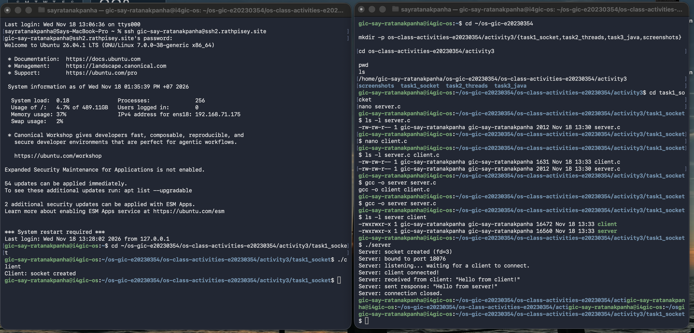
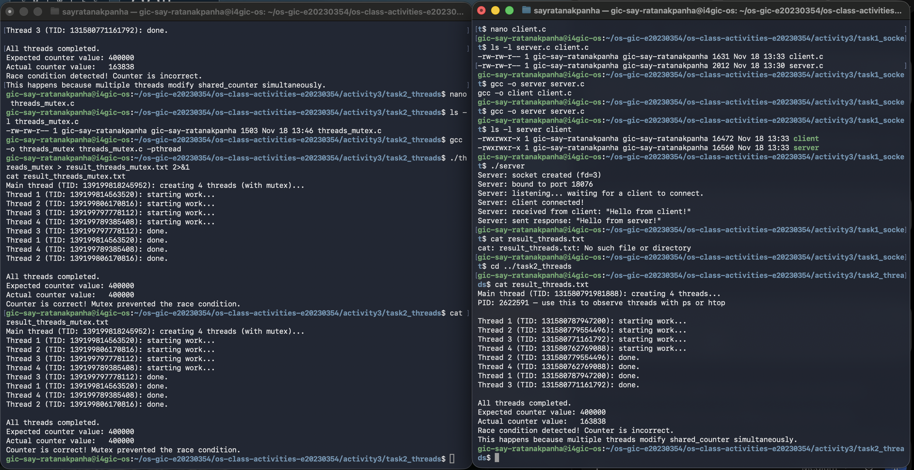
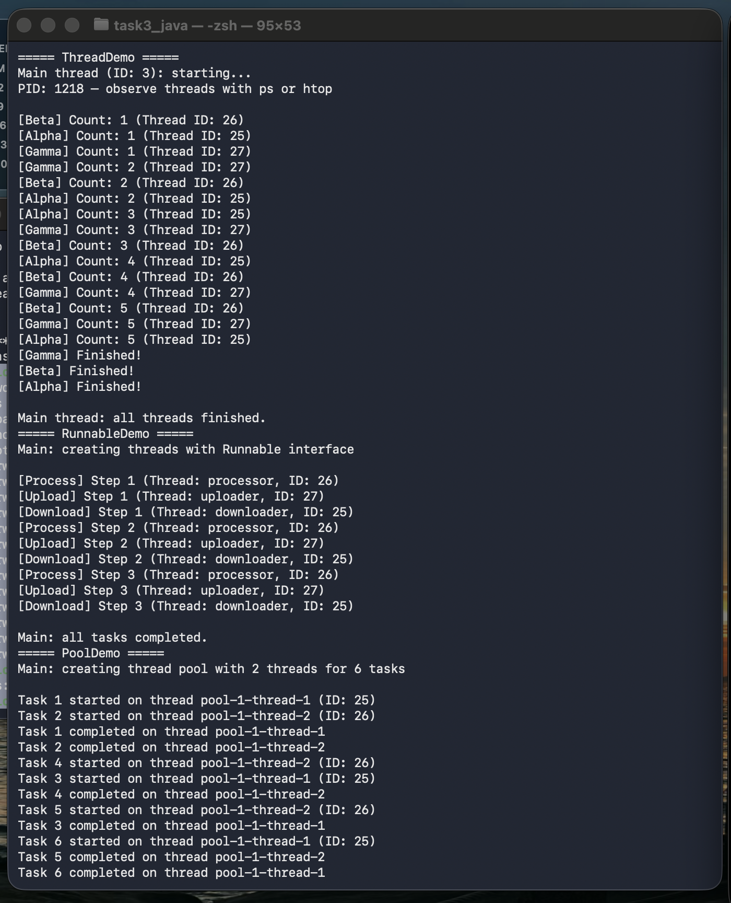
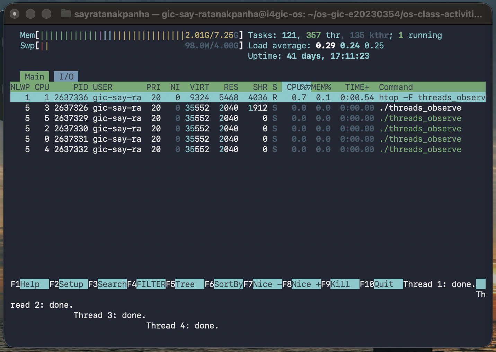
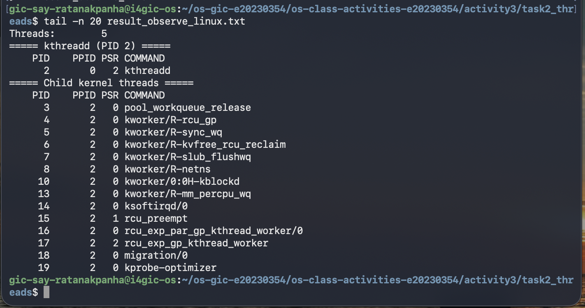
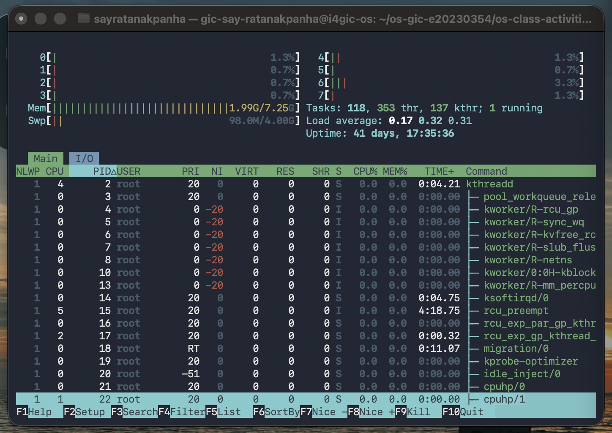
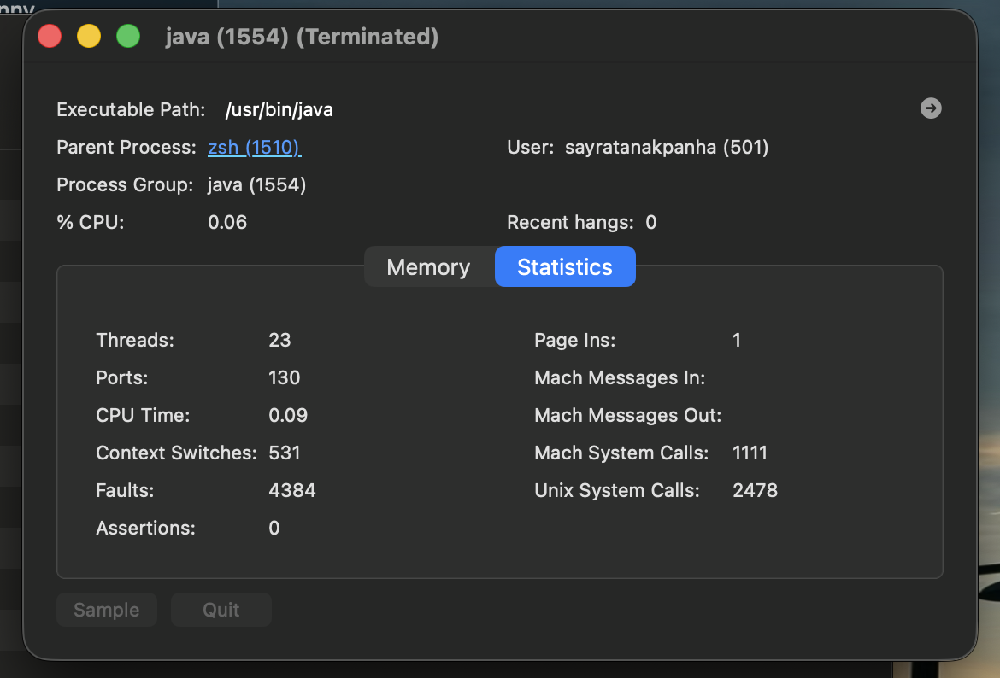

# Class Activity 3 — Socket Communication & Multithreading

- **Student Name:** Say Ratanakpanha
- **Student ID:** e20230354
- **Date:** November 18, 2026

## Objective

This activity explores TCP socket communication, POSIX threads, Java multithreading, and operating-system thread observation.

The programs were developed and tested using a school Ubuntu server and a MacBook. Linux was used for socket communication, POSIX threads, and kernel-thread observation. macOS was used for Java development and thread observation because Java was not installed on the school server.

---

## Task 1: TCP Socket Communication (C)

### Compilation and Execution

The TCP server and client were implemented in C using POSIX sockets.

Both programs used port `18076` to avoid port conflicts on the shared Ubuntu server.

Compilation commands:

```bash
gcc -o server server.c
gcc -o client client.c
```

The server was started first, followed by the client in another terminal.

The client sent:

```text
Hello from client!
```

The server responded:

```text
Hello from server!
```

Both programs communicated successfully.



### Answers

**1. What is the role of `bind()` in the server? Why doesn't the client call `bind()`?**

The `bind()` function associates the server socket with a local IP address and port number. This allows clients to know where to connect.

Our server uses port `18076`.

The client does not explicitly call `bind()` because the operating system automatically assigns an available local port when the client connects.

**2. What does `accept()` return? How is it different from the original server socket?**

The `accept()` function returns a new socket file descriptor representing the connection with a client.

The original server socket continues to represent the listening endpoint, while the new socket is used to exchange data with the connected client.

This allows a server to maintain its listening socket while handling client connections.

**3. What happens if you start the client before the server?**

I tested the client without running the server.

The result was:

```text
Client: socket created
Client: connecting to server on port 18076...
connect: Connection refused
```

The connection was refused because no server was listening on the specified port.

This demonstrates that the server must be listening before the client can establish the connection.

**4. What does `htons(PORT)` do? Why is byte-order conversion needed?**

`htons()` means "host to network short."

It converts a 16-bit value, such as a TCP port number, from the host's byte order into network byte order.

Network protocols use big-endian byte order. The conversion ensures that computers with different architectures interpret port numbers consistently.

**5. Draw the sequence of socket calls for both server and client.**

```text
SERVER                            CLIENT
  |                                 |
socket()                          socket()
  |                                 |
bind()                              |
  |                                 |
listen()                            |
  |                                 |
accept() <---------------------- connect()
  |                                 |
read()  <----------------------- send()
  |                                 |
send()  -----------------------> read()
  |                                 |
close(client_fd)                  close()
  |                                 |
close(server_fd)                     |
  |                                 |
 END                               END
```

### Evidence Files

- `task1_socket/server.c`
- `task1_socket/client.c`
- `task1_socket/result_socket.txt`
- `task1_socket/result_server.txt`
- `task1_socket/result_client.txt`
- `task1_socket/command_used_socket.txt`

---

## Task 2: POSIX Threads (C)

### Compilation and Execution

This task demonstrates creating multiple threads using the POSIX Threads library.

Four worker threads incremented a shared counter 100,000 times each.

The expected counter value was:

```text
4 × 100000 = 400000
```

### Experiment 1 — Without Mutex

Compilation:

```bash
gcc -o threads threads.c -pthread
```

Actual result:

```text
Expected counter value: 400000
Actual counter value:   163838
Race condition detected! Counter is incorrect.
```

The result was incorrect because multiple threads modified the shared counter without synchronization.

### Experiment 2 — With Mutex

Compilation:

```bash
gcc -o threads_mutex threads_mutex.c -pthread
```

Actual result:

```text
Expected counter value: 400000
Actual counter value:   400000
Counter is correct! Mutex prevented the race condition.
```

The mutex successfully protected the shared counter.

### Results Comparison

| Experiment | Expected | Actual | Result |
|---|---:|---:|---|
| Without mutex | 400000 | 163838 | Race condition |
| With mutex | 400000 | 400000 | Correct |



### Experiment 3 — Without pthread_join()

I created `threads_no_join.c` to observe what happens when `pthread_join()` is removed.

First execution:

```text
Expected counter value: 400000
Actual counter value:   13115
```

Second execution:

```text
Expected counter value: 400000
Actual counter value:   15696
```

The main thread printed "All threads completed" before the worker threads finished.

This occurred because the main thread did not wait for the workers before exiting.

### Answers

**1. What is a race condition? Why does `shared_counter` produce an incorrect result?**

A race condition occurs when multiple threads access shared data concurrently and the result depends on their execution order.

In this experiment, each thread executed:

```c
shared_counter++;
```

This operation involves reading, incrementing, and writing the shared value.

When multiple threads perform these steps concurrently, one thread may overwrite another thread's update.

As a result, the final counter was `163838` instead of `400000`.

**2. What does `pthread_mutex_lock()` do? Why does it fix the race condition?**

`pthread_mutex_lock()` acquires a mutex, preventing other threads from entering the protected critical section while the lock is held.

The mutex protects the increment operation:

```c
pthread_mutex_lock(&counter_mutex);
shared_counter++;
pthread_mutex_unlock(&counter_mutex);
```

This ensures that only one thread modifies the shared counter at a time.

The final result was exactly `400000`.

**3. What happens if you forget to call `pthread_join()`?**

Without `pthread_join()`, the main thread does not wait for worker threads to finish.

In my experiment, the program printed "All threads completed" even though the workers had not finished.

The counter values were `13115` and `15696` in two executions.

Returning from `main()` terminates the process, which also terminates unfinished worker threads.

**4. How is a thread different from a process? What do threads share?**

A process is an independent running program with its own virtual address space and resources.

A thread is a unit of execution within a process.

Threads belonging to the same process share:

- Code and global data
- Heap memory
- Open file descriptors
- Process address space

Each thread has its own:

- Stack
- CPU register state
- Thread identifier
- Execution state

Threads are generally less expensive to create and communicate between than separate processes.

### Evidence Files

- `task2_threads/threads.c`
- `task2_threads/threads_mutex.c`
- `task2_threads/threads_no_join.c`
- `task2_threads/result_threads.txt`
- `task2_threads/result_threads_mutex.txt`
- `task2_threads/result_threads_no_join.txt`
- `task2_threads/command_used_threads.txt`

---

## Task 3: Java Multithreading

This task demonstrates three approaches to Java multithreading:

1. Extending the `Thread` class
2. Implementing the `Runnable` interface
3. Using `ExecutorService`

Java OpenJDK 25 was installed on macOS for this task.

### ThreadDemo — Extending Thread

Compilation and execution:

```bash
javac ThreadDemo.java
java ThreadDemo
```

The program created three threads:

| Thread | Thread ID | Work |
|---|---|---|
| Alpha | 25 | Count 1–5 |
| Beta | 26 | Count 1–5 |
| Gamma | 27 | Count 1–5 |

The threads ran concurrently, and their printed output was interleaved.

The main thread waited until all three threads finished.

### RunnableDemo — Implementing Runnable

Compilation and execution:

```bash
javac RunnableDemo.java
java RunnableDemo
```

The program created three tasks:

| Task | Thread Name | Thread ID |
|---|---|---|
| Download | downloader | 25 |
| Process | processor | 26 |
| Upload | uploader | 27 |

Each task executed three steps.

The Process task printed first, even though the Download thread was started first. This demonstrates that thread execution order is determined by scheduling.

### PoolDemo — ExecutorService

Compilation and execution:

```bash
javac PoolDemo.java
java PoolDemo
```

The program created a fixed thread pool with two workers and submitted six tasks.

Observed worker threads:

```text
pool-1-thread-1
pool-1-thread-2
```

All six tasks completed successfully.

Only two tasks could execute simultaneously because the pool contained two worker threads.

The threads were reused to execute additional tasks.



### Answers

**1. What is the difference between extending Thread and implementing Runnable? When would you prefer one?**

Extending `Thread` creates a class that represents a thread and defines its work by overriding `run()`.

Implementing `Runnable` defines a task independently of the thread that executes it.

`Runnable` is generally preferred because it separates task logic from thread management and allows the class to extend another class if needed.

**2. Why do only two tasks run simultaneously in PoolDemo?**

The program uses:

```java
Executors.newFixedThreadPool(2);
```

This creates a thread pool with two worker threads.

Although six tasks are submitted, only two can execute concurrently. The remaining tasks wait in the executor's queue until a worker becomes available.

**3. What does `thread.join()` do in Java? What happens if you remove it?**

`thread.join()` makes the calling thread wait until the specified thread finishes.

In `ThreadDemo`, the main thread calls `join()` on Alpha, Beta, and Gamma.

Without these calls, the main thread could print its final message before the worker threads finish.

However, unlike the POSIX experiment where `main()` returning terminates the process, ordinary Java worker threads are non-daemon threads and normally keep the JVM running until they finish.

**4. Why is ExecutorService better than manually creating threads for large applications?**

`ExecutorService` manages and reuses worker threads.

Its advantages include:

- Reducing repeated thread-creation overhead
- Limiting the number of concurrent worker threads
- Queuing tasks
- Separating task submission from execution
- Supporting controlled shutdown and task management

This makes thread management more scalable and easier to maintain.

### Evidence Files

- `task3_java/ThreadDemo.java`
- `task3_java/RunnableDemo.java`
- `task3_java/PoolDemo.java`
- `task3_java/result_thread_demo.txt`
- `task3_java/result_runnable_demo.txt`
- `task3_java/result_pool_demo.txt`
- `task3_java/command_used_java.txt`

---

## Task 4: Observing Threads in Linux and macOS

### Part A — Linux Thread Observation

A C program named `threads_observe.c` was created.

The program starts four worker threads that sleep for 60 seconds, allowing their execution to be observed using Linux commands.

Compilation:

```bash
gcc -o threads_observe threads_observe.c -pthread
```

### Observation 1 — ps

The command used was:

```bash
ps -L -o pid,lwp,nlwp,psr,stat,comm -p 2635240
```

Observed results:

| PID | LWP | NLWP | PSR |
|---|---|---|---|
| 2635240 | 2635240 | 5 | 2 |
| 2635240 | 2635243 | 5 | 0 |
| 2635240 | 2635244 | 5 | 4 |
| 2635240 | 2635245 | 5 | 1 |
| 2635240 | 2635246 | 5 | 3 |

All five threads belonged to the same process but had different thread identifiers.

The `PSR` values show the CPU cores where the threads last executed.

### Observation 2 — /proc

Commands:

```bash
ls /proc/2636323/task/
grep -E 'Name|State|Threads' /proc/2636323/status
```

Actual thread IDs:

```text
2636323
2636326
2636327
2636328
2636329
```

Process status:

```text
Name:    threads_observe
State:   S (sleeping)
Threads: 5
```

This confirms that the main thread and all four workers were visible in the Linux `/proc` filesystem.

These PIDs were recorded during the experiment and are no longer expected to remain active.

### Observation 3 — htop User Threads

Using `htop`, I observed five threads belonging to `threads_observe`.

The `NLWP` column showed five threads, and the CPU/PROCESSOR column displayed the last CPU core used by each thread.



### Observation 4 — Linux Kernel Threads

The Linux kernel has its own threads for internal background operations.

I used:

```bash
ps -o pid,ppid,psr,comm -p 2
ps --ppid 2 -o pid,ppid,psr,comm | head -15
```

The results confirmed that `kthreadd` has PID 2.

Some observed kernel threads were:

| PID | PPID | Name |
|---|---|---|
| 2 | 0 | kthreadd |
| 4 | 2 | kworker/R-rcu_gp |
| 14 | 2 | ksoftirqd/0 |
| 15 | 2 | rcu_preempt |
| 18 | 2 | migration/0 |

The child kernel threads have PPID 2 because they are children of `kthreadd`.

#### Terminal Evidence



#### htop Kernel Thread Tree

The `htop` tree view displayed `kthreadd` and its child kernel threads.



### Part B — macOS Java Thread Observation

**Environment limitation:** The original activity requires Windows Task Manager. I only had access to macOS and the school Ubuntu server, so I used macOS Activity Monitor as an alternative. This observation does not constitute the requested Windows Task Manager evidence.

The Java program was modified locally to sleep for five seconds between counts, allowing time to observe its running threads.

The program created three Java worker threads.

macOS Activity Monitor displayed the following information:

| Information | Observed Value |
|---|---|
| Process | java |
| PID | 1554 |
| Parent process | zsh |
| Java worker threads created | 3 |
| Total process threads | 23 |

The JVM creates internal threads in addition to the three worker threads.



### Answers

**1. In `ps -eLf`, what does the LWP column mean?**

LWP stands for Lightweight Process.

In Linux thread listings, it identifies an individual thread.

Threads within the same process have the same PID but different LWP identifiers.

**2. How many entries were found in `/proc/<PID>/task/`?**

I found five entries.

This matches the program's five threads: one main thread and four worker threads.

**3. Why does Java show more threads than the three created?**

The Java Virtual Machine creates additional threads to manage garbage collection, runtime services, compilation, and other internal activities.

Using macOS Activity Monitor, I observed 23 total threads even though the program explicitly created only three workers.

This answers the general JVM thread-count concept, but it was not observed using Windows Task Manager.

**4. Compare Linux and Windows thread viewing. Which provides more detail?**

Linux tools such as `ps -L`, `/proc/<PID>/task/`, and `htop` allow users to inspect individual thread IDs, states, CPU placement, and thread counts.

Windows Task Manager provides a graphical view of process-level thread counts. More detailed Windows thread information can be obtained using other tools, such as Process Explorer.

Linux provides more direct thread-level detail through the tools used in this activity.

Windows Task Manager was not tested directly because a Windows system was unavailable.

**5. What is kthreadd? What is its PID? Name three kernel threads.**

`kthreadd` is a Linux kernel thread responsible for creating and managing other kernel threads.

Its PID is 2.

Three kernel threads observed were:

- `kworker/R-rcu_gp`
- `ksoftirqd/0`
- `rcu_preempt`

They are recognized as kernel threads because they belong to the kernel's thread hierarchy under `kthreadd` and have PPID 2.

**6. Which thread has an ID equal to PID? What is NLWP? Which cores were used?**

The main thread has a thread ID equal to its process ID.

In my observation:

```text
PID = 2635240
Main thread LWP = 2635240
NLWP = 5
```

NLWP means Number of Lightweight Processes, representing the number of threads in the process.

My five threads were observed with PSR values:

```text
2, 0, 4, 1, 3
```

These are the CPU cores on which the threads last executed during that observation.

**7. What do H and K do in htop?**

`H` toggles the visibility of user-space threads.

When user threads are shown, individual threads of a process can appear as separate rows.

`K` toggles the visibility of kernel threads.

When kernel threads are visible, threads such as `kworker` and `ksoftirqd` can be inspected. When hidden, these kernel threads do not appear in the normal process list.

### Evidence Files

- `task2_threads/threads_observe.c`
- `task2_threads/result_observe_linux.txt`
- `screenshots/task4_htop_threads.png`
- `screenshots/task4_htop_kernel_threads.png`
- `screenshots/task4_kernel_threads.png`
- `screenshots/task4_activity_monitor_threads.png`

---

## Reflection

This activity helped me understand how processes communicate and how threads execute within a process.

In Task 1, I learned how TCP sockets allow two separate programs to communicate. I observed how the server listens for connections, accepts a client, receives a message, and sends a response.

In Task 2, I found the race-condition experiment particularly interesting. Although four threads were expected to increment a counter to 400000, the result was only 163838. After adding mutex synchronization, the counter became correct. This demonstrated why protecting shared data is important in concurrent programming.

Task 3 introduced several ways to create threads in Java. I learned that extending `Thread` and implementing `Runnable` are different approaches to defining concurrent tasks. The thread-pool example showed how worker threads can be reused efficiently.

In Task 4, I observed that the Linux operating system manages individual threads with their own identifiers while keeping them inside the same process. I also discovered that the Linux kernel runs separate internal threads, such as `kworker` and `ksoftirqd`.

Overall, understanding thread scheduling, synchronization, and operating-system thread observation helps developers build more reliable concurrent applications. It also makes it easier to investigate issues involving performance, race conditions, and thread management.

---

## Conclusion

All three programming tasks were compiled and executed successfully.

The TCP client and server exchanged messages correctly. The POSIX thread program demonstrated a race condition and its correction using mutex synchronization. The Java programs demonstrated thread creation, Runnable tasks, and thread-pool management.

Linux thread and kernel-thread observations were completed using `ps`, `/proc`, and `htop`.

Because Windows was unavailable, macOS Activity Monitor was used as an alternative for the Java process thread-count observation. The Windows-specific screenshot requirement remains unfulfilled.

All available source files, command histories, output results, and screenshots are included in this repository.
